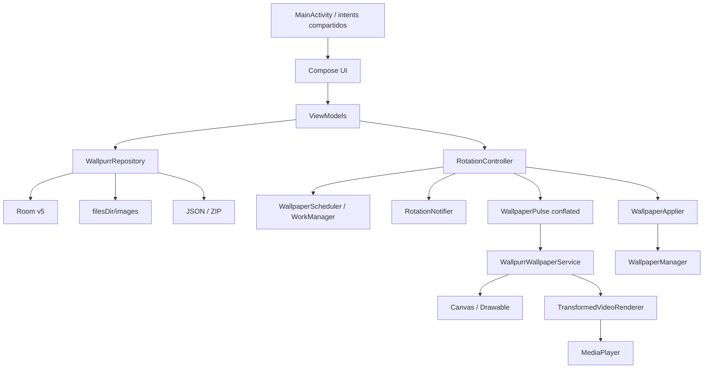
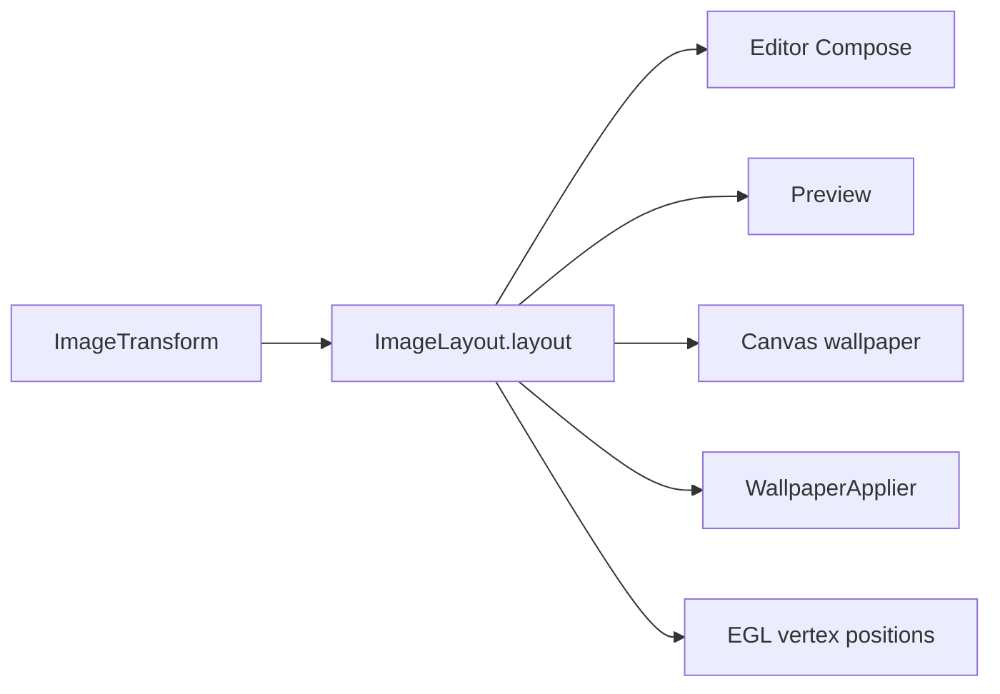
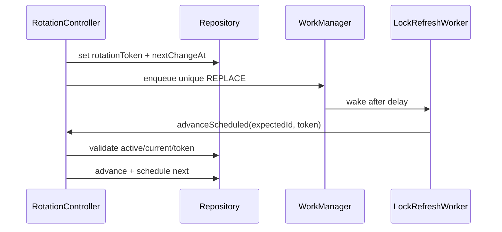
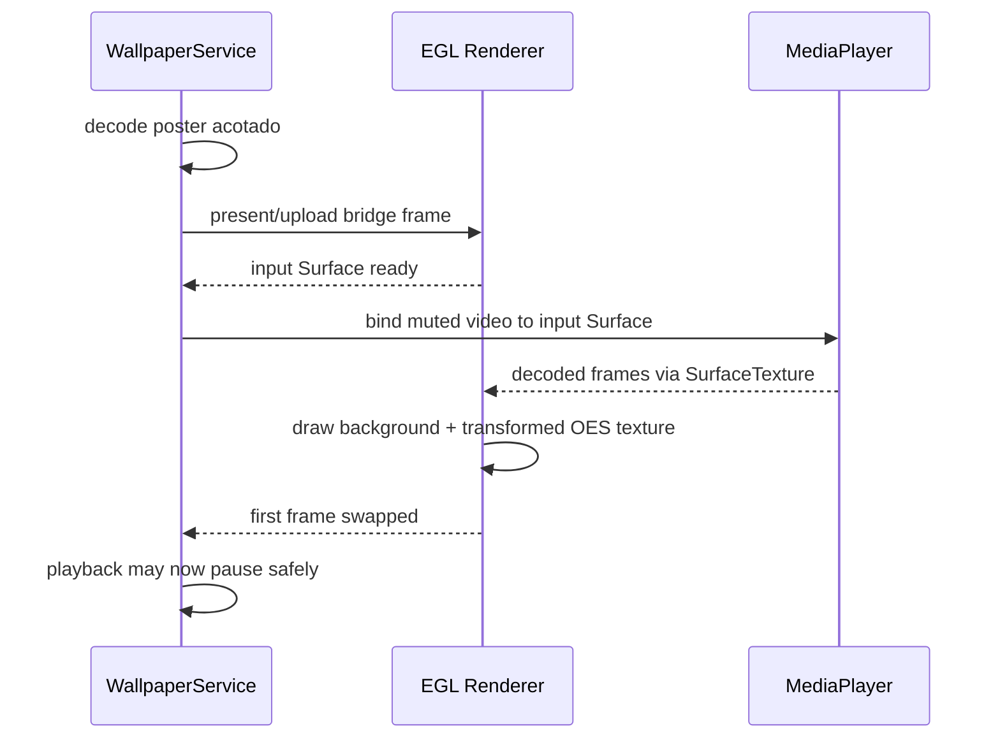

# Arquitectura de Wallpurr

Snapshot del árbol: 24 de agosto de 2026.

Este documento describe cómo se conectan los componentes y por qué existen algunas decisiones poco comunes. Para invariantes operativos y diagnóstico, consulta [CRITICAL_PATHS.md](CRITICAL_PATHS.md).

## Objetivos de diseño

- Operar completamente offline.
- Preservar los archivos originales.
- Ofrecer el mismo encuadre en editor, preview y wallpaper real.
- Mantener una sola fuente de verdad para el orden y el tiempo de rotación.
- Evitar recrear surfaces, players y bitmaps grandes durante cada cambio.
- Degradar a un frame estático cuando el destino o los efectos no permiten animación.
- Tolerar callbacks tardíos, reinicios del proceso y diferencias entre fabricantes.

## Vista general



No hay framework de inyección de dependencias. `WallpurrApplication` crea un `AppContainer` singleton con base de datos, repository, scheduler, notifier, applier, controller y monitor de ahorro.

## Entrada, navegación y UI

### `MainActivity`

- Activa edge-to-edge.
- Entrega la UI Compose.
- Procesa `ACTION_SEND` y `ACTION_SEND_MULTIPLE` tanto al iniciar como en `onNewIntent`.
- Extrae URIs desde `EXTRA_STREAM` o `ClipData`; la importación real ocurre después en el repository.

### `WallpurrApp`

La ruta raíz `tabs` contiene un `HorizontalPager` con:

1. Biblioteca.
2. Playlists.
3. Ajustes.

En pantallas menores de 600 dp usa `NavigationBar`; en tablets usa `NavigationRail`. Rutas secundarias:

- `playlist/{playlistId}`
- `editor/{imageId}?playlistId=...`
- `preview/{imageId}/{orientation}?playlistId=...`
- `apply/{playlistId}`

La UI usa ViewModels creados por las factories de `ui/ViewModelExt.kt`; los ViewModels hablan con repository/controller, no directamente con DAOs o el servicio.

## Persistencia

### Archivos privados

`ImageFileStore` copia cada URI a:

```text
<app filesDir>/images/<uuid>.<extensión>
```

Al importar:

1. Intenta conservar permiso persistente del URI si el proveedor lo permite.
2. Detecta `IMAGE`, `GIF` o `VIDEO` por MIME/nombre y metadata.
3. Copia el stream completo.
4. Lee dimensiones, duración y rotación de video.
5. Elimina la copia parcial si algo falla.

La app usa la copia después de importar; no depende de que el URI original siga disponible.

### Room v5

| Tabla | Propósito |
| --- | --- |
| `folders` | Biblioteca raíz y carpetas creadas por el usuario; marca `hidden` |
| `images` | Metadata del medio y configuración de video/lock propia |
| `transforms` | Perfil por `imageId + orientation` |
| `playlists` | Nombre, intervalo, destino, estilo de lock base y marca `hidden` |
| `playlist_items` | Relación y `sortOrder` |
| `shuffle_cursors` | Elemento actual, historial y pendientes |
| `settings` | Estado global y flags simples |

La “Biblioteca” también es una carpeta persistida. Su id se guarda en `settings`; borrar otra carpeta mueve sus medios de vuelta a esa raíz antes de borrar la carpeta.

Campos de transform relevantes:

- zoom y offset normalizado;
- `CONTAIN`, `COVER` o `STRETCH`;
- rotación;
- relleno de franjas `NONE`, `COLOR` o `BLUR`;
- color ARGB opaco.

Settings globales principales:

- playlist activa;
- pausa de rotación;
- token y hora del próximo cambio;
- pausa de GIF/video cuando el engine está oculto;
- permiso lógico para video en lockscreen;
- cambio por tap en Home;
- política de ahorro;
- política para volver a ocultar el contenido oculto;
- 2–4 columnas de biblioteca.

### Repository

`WallpurrRepository` es la única fachada pública de persistencia. Agrupa:

- flows reactivos para UI;
- operaciones transaccionales de carpetas/playlists;
- importación y borrado de copias privadas;
- conversión entity ↔ modelo de dominio;
- persistencia del cursor;
- settings;
- decodes acotados;
- backups.

No guarda objetos de UI ni referencias a `Surface`/`Bitmap` de runtime.

### Contenido oculto

- `HiddenContentGate` (en `AppContainer`) guarda en memoria si lo oculto está revelado. Nunca se persiste: un arranque en frío empieza oculto.
- Los flows `folders`, `playlists` e `images` del repository filtran lo oculto, así que todas las pantallas y selectores respetan el estado sin lógica propia. El contenido de una playlist visible no se filtra: muestra lo que el fondo va a mostrar, y una lista parcial rompería el reordenamiento.
- Se revela con pulsación larga en el título de Biblioteca o Playlists y `BiometricPrompt` (biometría débil o credencial del dispositivo; en Android 9, `createConfirmDeviceCredentialIntent`). Sin bloqueo de pantalla basta el gesto.
- `MainActivity.onStop` (sin contar la recreación por rotación) aplica la política: al salir, tras N minutos o manual. Al ocultarse, la navegación vuelve a las pestañas. En Android 13+ se desactiva la captura de Recientes mientras está revelado.
- La notificación usa "Wallpurr" en vez del nombre de una playlist oculta.
- Es discreción, no seguridad: los archivos no se cifran, los respaldos los incluyen y el fondo muestra la playlist activa aunque esté oculta.

### Backups

- JSON: metadata y configuración; si no están las copias privadas, reporta medios faltantes.
- ZIP: `config.json` más `images/<storedName>`.
- El JSON usa defaults e `ignoreUnknownKeys` para compatibilidad.
- La entrada `config.json` está limitada a 16 MiB.
- Los nombres de archivo pasan por validación para evitar rutas fuera de `imagesDir`.

## Geometría de medios

`editor/ImageLayout.kt` es una dependencia transversal.



`ImageTransform` guarda valores independientes por orientación. `ImageLayout`:

- calcula el scale base para contain/cover/stretch;
- aplica zoom, rotación y offset;
- limita el pan para no dejar huecos indebidos cuando corresponde;
- calcula el máximo lado de decode necesario para evitar cargar resolución que no llegará a pantalla.

Los cuatro giros físicos del dispositivo se agrupan en dos perfiles: ambas posiciones verticales
usan `PORTRAIT` y ambas horizontales usan `LANDSCAPE`. El engine conserva cuál perfil está cargado
y escucha tanto el cambio de `Configuration` como el cambio de tamaño del `Surface`. Esto es
necesario en tablets y launchers que mantienen las dimensiones del wallpaper aunque el dispositivo
ya haya girado. Al cambiar de grupo, vuelve a leer el transform persistido antes de redibujar; no
debe reutilizar el transform de la orientación anterior.

El engine mantiene una sola `desiredOrientation`. Las señales duplicadas de configuración/surface
se colapsan y las recargas de orientación se serializan. Si el usuario vuelve al perfil ya cargado
mientras el perfil opuesto sigue decodificando, se incrementa `loadGeneration` para impedir que esa
carga tardía reemplace el estado correcto.

El relleno de `CONTAIN` mantiene el foreground intacto y dibuja detrás:

- un color sólido; o
- un bitmap reducido, difuminado y en `COVER` con zoom 1.25.

Cuando el modo está en `NONE` o el fit no es `CONTAIN`, no debe existir backdrop extra.

## Orden de playlist

`ShuffleState` contiene:

```text
historyIds | currentImageId | remainingIds
```

`ShuffleEngine` es puro y no accede a Android ni Room. Soporta:

- inicio ordenado o barajado;
- siguiente con loop;
- anterior con wrap del primero al último;
- selección directa sin perder lo que queda antes/después en el ciclo actual;
- `reconcile`: alinear el cursor con los miembros actuales sin reiniciar el ciclo.

El repository persiste el resultado después de cada operación. Cambiar miembros reconcilia el cursor:
quita ids inválidos, agrega los nuevos a los pendientes y conserva el medio actual. Reordenar usa el
nuevo orden como ciclo, posicionado en el medio actual. Ver `CRITICAL_PATHS.md` §3.

## Coordinación de rotación

`RotationController` es el punto de serialización. Un `Mutex` ordena comandos programados y cambios de estado.

### Avance manual

Anterior/siguiente desde notificación o tap usan:

- `AtomicBoolean manualAdvanceInFlight`: descarta taps mientras otro cambio sigue activo.
- guard de 750 ms: evita dos cambios casi simultáneos desde fuentes diferentes.
- `change_on_home_tap`: desactiva el gesto accidental del launcher.

No se crea una cola de diez avances si el usuario toca diez veces.

### Scheduling

Solo hay un one-shot único de WorkManager:



La validación doble impide que un worker viejo salte un medio después de una acción manual o reconfiguración.

Reglas de tiempo:

- Imagen/GIF: intervalo de playlist.
- Video `MINUTES`: minutos propios del medio.
- Video `TIMES`: si se reproduce en un destino live, el callback de finalización/loops avanza; si se usa como frame estático, aplica el intervalo de playlist.

`BootReceiver` llama `restoreSchedule()` después del reinicio.

### Aplicación y publicación

Al cambiar estado, el controller:

1. emite `WallpaperPulse.Reload` para engines live;
2. pide actualizar la notificación;
3. si Lock no es live, envía una solicitud conflated para aplicar el frame estático.

El bitmap de lock se genera fuera del mutex para no bloquear siguientes acciones.

## Live wallpaper

### Responsabilidad del servicio

`WallpurrWallpaperService` mantiene uno o más engines: preview, Home, Lock o una instancia compartida. Cada engine lee:

- playlist activa y cursor;
- destino configurado;
- orientación actual del dispositivo, con el tamaño del surface como fallback;
- transform;
- política de ahorro;
- estilo visible de lock;
- flags de reproducción.

`wallpaperFlags` y `WallpaperManager` determinan qué pantalla representa realmente un engine. Un solo engine puede representar Home+Lock.

### Elección del medio efectivo

El source guardado no siempre coincide con lo que se renderiza:

| Source | Condición | Render efectivo |
| --- | --- | --- |
| Cualquiera | Ahorro `STATIC` activo | Frame estático elegido por política |
| Video | Engine solo Lock y video lock apagado | Frame estático |
| Video | Engine solo Lock con blur/oscuridad | Frame estático |
| GIF | Engine solo Lock con blur | Frame estático |
| Video/GIF | Destino live compatible y sin bloqueo anterior | Animación |

La política `STATIC` elige la primera imagen real de la lista; si no existe, usa el primer medio y lo congela como frame.

### Canvas y EGL

Hay dos rutas:

- Canvas/Drawable: GIF, imágenes con efectos o fallbacks.
- EGL persistente: video y, cuando es posible, imágenes estáticas sin efectos.

Usar EGL también para stills rápidos permite conservar el productor del window surface entre imagen y video. Esto reduce desconexiones, flashes negros y conflictos de `BufferQueue` observados en Samsung.

### Transición a video



`TransformedVideoRenderer` posee un `HandlerThread`. En ese hilo crea y libera EGL, shaders, texturas, `SurfaceTexture` y la `Surface` que recibe `MediaPlayer`.

El tamaño efectivo para EGL se obtiene del propio `EGLSurface`, no solo del callback del servicio.
El renderer reconcilia el viewport inmediatamente y varias veces durante el asentamiento de una
rotación de tablet para evitar que un buffer redimensionado conserve un `glViewport` pequeño.

Para video→video, el renderer y su window surface permanecen; se reemplaza solo el decoder/player. Para video→imagen, la imagen se sube como textura 2D al mismo renderer.

### Transiciones de fondo y orientación

La transición visual sigue el modelo de dos picture sets de Muzei, adaptado al pipeline mixto de
Wallpurr:

- EGL compone primero la escena saliente completa y la conserva en una textura RGB del framebuffer;
- cuando la escena entrante está lista, conserva una segunda textura ya compuesta;
- `Choreographer` mezcla ambas con interpolación accelerate/decelerate durante 750 ms;
- una corrección de viewport/orientación usa el mismo mecanismo con 240 ms;
- video→video captura la escena saliente, cambia layout/backdrop y prepara el decoder en una sola
  operación del hilo EGL; espera un frame real nuevo antes de iniciar y no mantiene dos players;
- durante esos 750 ms el video entrante actualiza la textura target ya reservada mediante
  `glCopyTexSubImage2D`, sin allocations ni swaps extra y como máximo una vez por frame de
  `Choreographer`, para que al terminar no salte 750 ms;
- un cambio nuevo durante el fade captura el resultado visible actual y reemplaza el destino, en vez
  de encadenar animaciones viejas.

La orientación se publica en dos fases porque configuración y tamaño del Surface no siempre llegan
juntos en tablets. El renderer conserva una escena saliente completa, center-croppea ese holding
frame al Surface nuevo y deja de intercambiar frames con el transform anterior. Después de una
ventana de consolidación de 48 ms, servicio, renderer y backdrop reciben juntos el último perfil.
No debe existir una secuencia visible de transform anterior, resize y transición final.

El target conserva explícitamente la orientación esperada y solo se publica cuando EGL presenta la
misma. Así un buffer vertical transitorio no puede convertirse en el origen horizontal siguiente ni
acumular zoom con giros repetidos. Existe una espera máxima acotada para launchers cuyo Surface no
cambia dimensiones aunque sí cambie `Configuration.orientation`.

Las rutas Canvas aplican el mismo gate antes de construir su bitmap target. Mientras `SurfaceHolder`
conserve la orientación anterior, siguen publicando únicamente el holding saliente; un retry liviano
en Main crea el target al coincidir o al vencer el mismo fallback para surfaces estables.

Cada renderer consulta `GL_MAX_TEXTURE_SIZE` una sola vez al inicializar EGL. Una captura que excede
ese límite se omite de forma segura y no deja el pipeline marcado como transición pendiente.

Color, backdrop de `CONTAIN`, crop y foreground se capturan como una sola escena. Esto evita que la
opacidad se acumule de manera diferente en cada capa. Las texturas de transición existen solo
durante el cambio y se liberan en el hilo EGL al terminar o al ocultarse el engine.

El backdrop derivado, de máximo 720 px, sí puede permanecer residente mientras el mismo medio usa
`COVER` en la otra orientación. No contiene geometría ni transform, por lo que volver a `CONTAIN`
reutiliza de forma segura la misma textura/bitmap sin otra decodificación; cambia de medio o liberar
el renderer siempre invalida esa caché.

GIF y rutas Canvas usan dos bitmaps compuestos acotados a 2048 px, o 1024 px en dispositivos
marcados como low-RAM. En el raro hand-off EGL→Canvas,
el renderer hace un único readback acotado; la ruta normal imagen/video permanece GPU-only. El
traspaso Canvas→EGL sube el frame saliente antes de conectar el nuevo productor, preservando el
último buffer visible en Samsung. El blur de esos bitmaps compensa densidad y reducción de
resolución para no cambiar de radio perceptual cuando termina el fade y vuelve `RenderEffect`.

### Concurrencia y callbacks obsoletos

El engine usa dos identidades:

- `loadGeneration`: invalida un decode/load completo anterior.
- `videoSessionId`: invalida callbacks del player anterior sobre el mismo renderer.

Los callbacks también comparan referencias de renderer/player y el estado del surface.
Las preparaciones Canvas conservan además la generación esperada y la identidad del frame
saliente: un blur que termine tarde no puede instalar el destino de una carga u orientación vieja.
Al reemplazar video, el renderer vuelve a latchear el buffer más reciente después de
`MEDIA_INFO_VIDEO_RENDERING_START`, en vez de reconocer el frame retenido por el decoder anterior.

El cursor de playlist es observable desde Room. La pantalla de detalle no guarda una copia mutable:
acciones de notificación, Home, worker o UI actualizan el mismo `Flow<ShuffleState?>`.

### Visibilidad

GIF y video se pueden pausar cuando el engine no está visible. En video, algunos OEM reportan “prepared” antes de que el primer frame llegue al surface; por eso el código puede arrancarlo brevemente y posponer `pause()` hasta después del primer swap EGL.

## Lockscreen y efectos

`LockStyle` representa:

- difuminado ambiental entero 0–20; los niveles 0–10 conservan la curva anterior hasta 22 dp
  visuales y 11–20 aumentan con mayor fuerza hasta 100 dp;
- opacidad 0.8–1.0, convertida a oscurecimiento uniforme 0–20 %.

Resolución de prioridad:

```text
image.lockStyleOverride == true ? estilo de imagen : estilo de playlist
```

En un engine compartido Home+Lock no se debe hornear el efecto en el bitmap decodificado. `visibleLockStyle()` consulta keyguard y aplica el efecto al dibujar, para que Home permanezca limpio.

Android 12+ entrega una sola operación de `RenderEffect` a resolución exacta del Surface. Skia decide
internamente la profundidad necesaria para ese radio, evitando cuantizar la imagen entre varias
capas creadas por la app. Wallpurr no altera la saturación: conserva el color original, aplica un
dithering cromáticamente neutro de aproximadamente un nivel de 8 bits y combina el resultado con un
velo negro uniforme de hasta 8 %, siguiendo la composición blur + dim descrita por One UI. La textura
de dithering es de 128 px, periódica y filtrada para contener sólo alta frecuencia; evita banding sin
introducir grano de baja frecuencia. Los stills reutilizan el `RenderNode` para que el costo completo
se pague solamente al cambiar de escena o estilo.
Dispositivos anteriores usan tres pasadas CPU a resolución original y dithering ordenado de un solo
nivel para evitar bandas de 8 bits. El nivel 20 se limita a 384 px físicos. Con efectos 0/0 se omiten
todas esas capas.

## Aplicación estática

`WallpaperApplier` cubre dos casos:

- `applyLockStatic`: render + lock style + `FLAG_LOCK`.
- `applyHomeStaticFallback`: render + `FLAG_SYSTEM`.

Antes de aplicar Lock, el controller comprueba si Wallpurr ya posee una instancia live de bloqueo. En una instalación live compartida Android puede reportar `null` para el info específico de Lock; el código combina component e ids de wallpaper para evitar competir con el engine.

## Notificación

`RotationNotifier` publica una notificación ongoing con `RemoteViews` compacta y expandida.

- Compacta: miniatura, playlist, anterior y siguiente.
- Expandida: destino, hora/próximo estado, posición X de N, ahorro y pausa/play.

Tocar el cuerpo abre `MainActivity` y entrega el id de la playlist activa. La actividad expone esa
solicitud como estado y `WallpurrApp` navega a `playlist/{playlistId}` tanto desde arranque frío como
mediante `onNewIntent` si ya estaba abierta.

La publicación es conflated y espera 120 ms para dejar prioridad al render. La notificación no es un foreground service; Android/OEM puede ocultarla según permisos y ajustes de lockscreen.

`WallpaperActionReceiver` usa `goAsync()` y delega inmediatamente al `RotationController`.

## Ahorro de energía

`PowerSaveMonitor` escucha `ACTION_POWER_SAVE_MODE_CHANGED`.

- `IGNORE`: no cambia el comportamiento de Wallpurr.
- `STATIC`: cancela scheduling, bloquea avances manuales, elige contenido estático y reanuda la política normal al salir del modo.

El switch configura la política; no intenta activar el modo de ahorro del sistema.

## Caches y decisiones de rendimiento

- Decode de wallpaper basado en `requiredDecodeMaxSide`.
- Miniaturas derivadas de 480 px en `cacheDir` (96 MB máximo), compartidas por biblioteca,
  tarjetas y playlists. Se pre-generan al importar y en un backfill al abrir la biblioteca; las
  tiles leen las existentes incluso durante un fling y solo posponen generar las que faltan hasta
  que el scroll se asienta. Dos generadores simultáneos; el backfill usa uno a la vez.
- Renders estáticos finales en PNG sin pérdida (256 MB máximo), reutilizables por orientación,
  viewport, transform y estilo de bloqueo.
- Backdrop limitado a 720 px y retenido solo mientras aplica.
- Difuminado CPU con working set acotado y resolución proporcional a la intensidad.
- Un `RenderEffect` a resolución completa y cache de `RenderNode` para stills de lock.
- Coil mantiene la cache de memoria de UI; los posters sobreviven al cierre del proceso mediante la
  cache derivada en almacenamiento.
- Medios animados de cuadrícula sólo cuando están totalmente visibles y el scroll lleva 220 ms
  asentado. Se reproducen como máximo dos en teléfono y uno en anchos de tablet; videos y GIFs
  comparten ese límite. Los `ExoPlayer` de video se reutilizan con `GridVideoPlayerPool` (máx. 2
  inactivos, liberados tras 20 s sin uso o 15 s con la app en segundo plano).
- Pulsos, notificación y aplicación estática de lock conflated para absorber ráfagas.
- EGL/window surface persistente entre tipos de medio cuando no hay efectos.
- Crossfade sincronizado con `Choreographer`; cero frames programados cuando no hay transición o el
  wallpaper está oculto.
- Respeta `ValueAnimator.areAnimatorsEnabled()`: con animaciones del sistema desactivadas presenta
  directamente el destino.

## Mapa de archivos críticos

| Archivo | Rol |
| --- | --- |
| `WallpurrApplication.kt` | Composition root y señal de reload |
| `storage/WallpurrRepository.kt` | Fachada de datos/estado |
| `storage/ImageFileStore.kt` | Copia, metadata y decode |
| `editor/ImageLayout.kt` | Geometría compartida |
| `playlist/ShuffleEngine.kt` | Máquina de orden pura |
| `wallpaper/RotationController.kt` | Coordinador runtime |
| `wallpaper/WallpurrWallpaperService.kt` | Lifecycle y selección de pipeline |
| `wallpaper/TransformedVideoRenderer.kt` | EGL y composición de video |
| `wallpaper/WallpaperApplier.kt` | Home/Lock estático |
| `wallpaper/RotationNotifier.kt` | Estado y controles de notificación |
| `ui/editor/*` | Edición y persistencia de transforms |
| `ui/playlist/*` | Configuración y selección directa |
